# Architecture spine cible: plateforme interne de tarification dynamique d'Client Cible

Ce document fixe le contrat d'architecture cible pour remplacer le moteur tarifaire externe d'Opérateur HPA Européen par un actif décisionnel interne sous GCP et BigQuery. Il s'appuie sur un paradigme de pipeline batch serverless découplé. Le cœur transactionnel PMS central conserve l'inventaire, les grilles de sécurité, les caches de prix et la distribution multicanale, tandis que GCP exécute l'ingestion sans données personnelles, la prévision non contrainte, l'optimisation à double fonction objectif et l'explicabilité locale pour Aix-en-Provence, Montpellier et Breda.

L'architecture écarte toute inférence temps réel permanente et tout cluster Kubernetes de production. Elle s'adapte à une équipe Digital, Data & IT de 12 à 15 experts qui maintient déjà la BI et le CRM du groupe.

## 1. Capitalisation sur l'existant et frontières système

L'internalisation ne repart pas de zéro et ne réécrit aucun système transactionnel. Chaque brique existante reçoit un rôle borné ou une trajectoire de retrait explicite afin d'éviter la dispersion technique pendant la montée en charge sur 12 mois.

| Actif existant | Rôle dans l'architecture cible | Frontière et règle de couplage |
| :--- | :--- | :--- |
| PMS central (Éditeur PMS) et BI Snowflake | Socle transactionnel conservé (inventaire des 55 000+ unités, grilles de sécurité, 90+ passerelles OTA, accords CSE) et source de vérité des ventes | Lecture quotidienne en batch vers BigQuery; écriture unique par lots discrétisés via le connecteur 2-ways suivie d'un pré-chauffage des caches `semainier` et `journalier` |
| Socle GCP d'Aix-en-Provence | Plateforme cible unique de données, de transformation et de calcul batch (BigQuery, Dataform, Cloud Workflows, Cloud Run Jobs, Terraform, GitHub Actions) | Héberge tout le code versionné, les tables sans données personnelles et les modèles; les Cloud Run Jobs remplacent tout serveur d'inférence continu |
| Fork R&D `client_cible_repo` (GKE/Ray) | Cantonné aux expérimentations ponctuelles hors ligne des Data Scientists | Interdit dans la chaîne quotidienne de production afin d'éviter le maintien d'un cluster 24h/24 |
| Tracking web (Tealium, GA4) | Source des recherches sans disponibilité utilisées pour décontracter la demande estivale saturée à 100 % | Agrégation stricte par site, gamme, date et marché émetteur avant entrée dans le pipeline ML; suppression de tout cookie ou identifiant utilisateur |
| Tableau et Dash (Python) | Cockpit opérationnel d'explicabilité SHAP, de simulation "et si" et de saisie des motifs de débrayage | Lecture sur tables agrégées dédiées ou extraits Hyper (< 5 s) sans dépendance à BigQuery BI Engine; aucune écriture directe vers PMS central |
| Fichiers SQL Server et classeurs VBA locaux | Témoins d'audit en Phase 1 pour recenser les règles métier implicites et les contournements historiques | Reprise des règles validées dans Dataform et l'optimiseur; extinction progressive des ressaisies manuelles |
| Place de marché interne (PHP, Laravel, MariaDB, XML Connect) | Périmètre secondaire raccordé en lot dédié après stabilisation du cœur PMS central (Marque A, Marque C, Marque D, Resorts Annuels A) | Connecteur batch isolé alimentant le modèle canonique BigQuery afin de ne pas bloquer la bascule initiale |
| Moteur externe sortant (Prestataire externe `#rm-externe` ou Moteur historique) | Référence Champion pendant l'audit contrefactuel, le shadow mode et les tests appariés jusqu'à M9-M12 | Maintenu comme solution de repli avec les grilles de sécurité PMS central jusqu'au décommissionnement validé par la direction financière |

## 2. Topologie des couloirs d'exécution

La plateforme s'organise en quatre couloirs d'exécution séquencés par dépendances unidirectionnelles. Ce découpage permet aux équipes Data Engineering, Data Science et Revenue Management de livrer en parallèle sans casser l'intégrité des prix publiés.

```mermaid
flowchart LR
    subgraph L1["Couloir 1: Ingestion, audit et barrière sans PII"]
        RES["PMS central / Snowflake BI"] --> BQRAW["BigQuery raw_pms_central"]
        EXT["Historique Modèle externe"] --> BQRAW
        WEB["Tealium / GA4 agrégé"] --> BQRAW
        VBA["Règles SQL Server / VBA"] --> DF["Dataform @dataform/core"]
        BQRAW --> GUARD{"pii_schema_guard"}
        GUARD -->|"Rejet si PII"| ALERT["Kill-switch conformité"]
        GUARD -->|"Schéma conforme"| DF
        DF --> FEAT["BigQuery features_no_pii + Omnibus 30j"]
    end

    subgraph L2["Couloir 2: Calcul batch serverless (Cloud Workflows < 90 min)"]
        FEAT -->|"Exclusion débrayages bruts"| FC["Cloud Run: forecast-unconstraining-job"]
        FC -->|"Demande décontractée + Élasticité TTC"| OPT["Cloud Run: constrained-optimizer-job"]
        OPT -->|"Propre: CA +12% annexes | TO: Marge nette HT"| DEC["BigQuery pricing_decisions + SHAP"]
    end

    subgraph L3["Couloir 3: Cockpit explicable et publication PMS central"]
        DEC -->|"Extraits Hyper / Tables agrégées < 5s"| COCKPIT["Cockpit Tableau / Dash (RBAC Aix/MPL/Breda)"]
        COCKPIT -->|"Hors été: auto dans borne | Juil-Août: validation humaine"| GATE["File de publication validée"]
        COCKPIT -->|"Débrayage motif 1 ligne"| OVR["Journal immuable overrides"]
        OVR -->|"Contexte uniquement"| DF
        GATE -->|"Lots discrétisés 2-ways"| PUB["Cloud Run: pms_central-publisher-job"]
        PUB --> RAPI["PMS central 2-ways + Pré-chauffage caches GraphQL"]
    end

    subgraph L4["Couloir 4: Surveillance, repli < 2h et Phase 4"]
        RAPI -->|"Contrôle parité <= 0.5%"| MON["Cloud Run: drift-monitor-job & Kill-switches"]
        MON -->|"Anomalie critique"| FB["Repli grilles sécurité PMS central < 2h"]
        VEILLE["Veille prix publics (Phase 4)"] --> DF
        DEC --> SEM["Couche sémantique gouvernée BigQuery"]
        SEM -->|"Mention AI Act art. 50"| BOT["Assistant analytique conversationnel"]
    end
```



### Couloir 1: ingestion, audit contrefactuel et barrière sans données personnelles

Chaque nuit, un flux batch extrait de PMS central et de sa couche Snowflake les réservations, les disponibilités, les tarifs publiés, les restrictions (`MinLOS`, `CTA`, `CTD`) et les annulations, ainsi que l'historique des recommandations du prestataire externe. Les signaux de recherches sans disponibilité issus de Tealium et GA4 sont agrégés par site, gamme, date de séjour et marché émetteur avant d'atterrir dans le dataset brut BigQuery. En Phase 1, les règles tarifaires dispersées dans SQL Server et VBA sont auditées pour être codées proprement dans Dataform, tandis que Place de marché interne reste isolé sur une branche d'ingestion différée.

Avant toute transformation analytique, une assertion Dataform bloquante (`pii_schema_guard`) inspecte les métadonnées et rejette tout chargement contenant un identifiant personnel (nom, adresse email, cookie individuel ou identifiant client). Une fois ce filtre franchi, Dataform calcule les tables versionnées sans PII (`booking_pace` comparé à N-1 et N-2 à J-x, `lead_time` par nationalité, calendriers scolaires européens, grilles de TVA locales intégrant les taux 2026 à 21 % aux Pays-Bas et 12 % en Belgique) ainsi que la table glissante sur 30 jours du prix le plus bas pratiqué pour la conformité Omnibus. C'est également sur ce socle que tourne l'audit contrefactuel de Phase 1 comparant le Modèle externe, les prix réellement publiés après débrayage et le Net RevPAC HT.

### Couloir 2: calcul décisionnel batch serverless à double fonction objectif

Orchestré par Cloud Workflows, le calcul quotidien démarre après la clôture des transformations Dataform et s'achève avant 07h30 CET en moins de 90 minutes. Il enchaîne deux conteneurs Docker éphémères exécutés sur Cloud Run Jobs, sans cluster permanent.

Le premier conteneur (`forecast-unconstraining-job`) estime la demande non contrainte par site, gamme, date et durée (séjour semaine et court séjour hors samedi-samedi). Il corrige la censure statistique des semaines fermées à 100 % en juillet et août en exploitant les recherches sans disponibilité Tealium/GA4. Il estime ensuite l'élasticité-prix sur le tarif TTC client, frais obligatoires de dossier et de ménage inclus, en excluant du jeu d'entraînement brut les observations issues de débrayages manuels. Pour les 5 à 10 acquisitions annuelles sans historique Client Cible, un sous-module d'apprentissage par transfert initialise les courbes en moins de 14 jours à partir de campings jumeaux.

Le second conteneur (`constrained-optimizer-job`) traduit les prix TTC en revenu net HT après déduction de la TVA locale, de la taxe de séjour et de la commission canal (91 % direct, OTA post-DMA, 2,5 % ANCV). Il résout ensuite sous OR-Tools et SciPy deux problèmes d'optimisation distincts selon le statut contractuel du camping: maximisation du revenu total HT incluant les 12 % de dépenses annexes sur les 117 sites en propre (dont Resorts Annuels A), et maximisation de la marge nette HT d'hébergement après loyer garanti, coûts de ménage et commissions sur les quelque 350 sites partenaires en tour-opérateur. L'optimiseur impose les bornes de variation quotidienne anti-volatilité, les prix planchers partenaires, les plafonds d'écart entre portails pays (Marque A, Marque C, Marque D), les mécaniques CSE (Coup par Coup à -40 %, Bouquet, Linéaire avec rétrocession à J-15) et les restrictions `MinLOS`, `CTA` et `CTD` destinées à combler les interstices du calendrier. Il calcule enfin les contributions locales SHAP et les intervalles de confiance écrits dans `pricing_decisions`.

### Couloir 3: cockpit explicable, arbitrage métier et publication PMS central

Chaque matin à 07h30 CET, les Revenue Managers et Pricing Analysts d'Aix-en-Provence, de Montpellier et de Breda accèdent dans Tableau ou Dash à leur périmètre régional filtré par RBAC. Afin de garantir un affichage sous 5 secondes malgré la sécurité au niveau des lignes et sans dépendre de BigQuery BI Engine, le cockpit consomme des tables de présentation pré-agrégées ou des extraits Hyper rafraîchis en fin de batch.

L'interface affiche la recommandation, sa décomposition SHAP (effet `booking_pace`, stock résiduel, calendrier, élasticité nationalité, fiscalité, canal), son intervalle de confiance et un simulateur "et si" permettant de tester un tarif alternatif avant envoi. Deux régimes de publication gouvernent l'écriture vers PMS central. Hors juillet et août, les recommandations comprises dans la bande de tolérance convenue partent automatiquement en production, tandis qu'en juillet et août chaque mouvement exige une validation humaine explicite. Tout débrayage manuel impose la sélection d'un motif structuré en une ligne (événement local, météo ou incendie, action concurrente, contrainte partenaire, accord CSE, autre). Ce journal alimente la revue mensuelle Data Science / Revenue Management mais n'entre jamais directement comme observation tarifaire dans la courbe d'élasticité brute.

La publication est assurée par `pms_central-publisher-job`, unique composant autorisé à appeler le connecteur bidirectionnel 2-ways de PMS central. Pour respecter la latence de l'API GraphQL (environ 4 secondes hors cache), le job agrège et discrétise les mises à jour par lots, suit les allocations Champion/Challenger par segments appariés, puis exécute un pré-chauffage planifié des caches `semainier` et `journalier` afin d'aligner le prix catalogue et le prix au paiement.

### Couloir 4: surveillance continue, repli sous deux heures et extension Phase 4

Une sonde hebdomadaire (`drift-monitor-job`) mesure la dérive des variables d'entrée, la dérive des prédictions et l'erreur MAPE/WAPE par segment, tandis que des contrôles quotidiens vérifient les quatre déclencheurs de kill-switch (recul financier Net RevPAC ou `booking_pace` > 5 % sur 14 jours, anomalie de TVA, de borne ou de parité cache-checkout > 1 %, taux de débrayage > 40 % sur 7 jours, ou détection de PII, retard PMS central > 24 heures et défaut sur la table Omnibus 30 jours). Au moindre dépassement, le système suspend l'écriture automatique et rétablit les grilles de sécurité PMS central (ou le Modèle externe en transition) en moins de 2 heures sans couper les ventes. Chaque prix publié reste auditable sur 24 mois grâce à l'archivage immuable du commit Git, du jeu de features daté, de l'artefact modèle et des paramètres d'optimisation.

En Phase 4 (M9-M12+), une fois le socle stabilisé, le couloir intègre la veille tarifaire concurrentielle multi-pays limitée strictement aux prix publics affichés, ainsi qu'une couche sémantique gouvernée dans BigQuery (Dataplex, BigQuery Conversational Analytics ou Tableau Semantics). Tout futur assistant conversationnel doit interroger exclusivement cette couche sémantique certifiée sur le Net RevPAC et afficher dès le premier échange la mention de transparence imposée par l'article 50 de l'AI Act.

### Règles de dépendance entre couloirs

Les flux obéissent à quatre règles strictes d'isolation qui empêchent les divergences entre modules construits indépendamment. Aucun composant du Couloir 3 (Tableau, Dash) ne dispose d'un accès en écriture vers PMS central ni vers les tables d'entraînement du Couloir 2. Aucun job du Couloir 2 ne lit directement les tables brutes contenant potentiellement des identifiants clients; il dépend exclusivement des vues certifiées par `pii_schema_guard`. Aucun agent conversationnel du Couloir 4 n'exécute du SQL généré sur des tables BigQuery brutes. Enfin, la séparation entre les tables de recommandations suivies et la table des débrayages manuels est imposée au niveau du schéma BigQuery avant la phase d'entraînement.

## 3. Invariants non négociables (AD-01 à AD-07)

Les sept invariants ci-dessous figent les décisions d'architecture qui ne peuvent pas être contournées par un lot ou un sprint particulier. Toute dérogation bloque la mise en production.

| ID | Invariant `[Statut]` | Périmètre lié | Règle d'implémentation concrète | Risque éliminé |
| :--- | :--- | :--- | :--- | :--- |
| AD-01 | Découplage strict PMS central/GCP, écriture 2-ways discrétisée et repli sous 2 heures `[ADOPTED]` | FR-01, FR-24, FR-25, NFR-03, NFR-08, Veto 4 | Conserver PMS central pour stocks, grilles de sécurité et canaux; canaliser toute écriture via `pms_central-publisher-job` en lots discrétisés suivis d'un pré-chauffage des caches `semainier` et `journalier`; maintenir une bascule d'urgence automatisée vers les grilles PMS central en < 2 heures | Dérive de projet en réécriture PMS de 24 mois, saturation de l'API GraphQL (4 s hors cache) et écart catalogue/checkout (> 0,5 % alerte, > 1 % kill-switch) |
| AD-02 | Exécution batch serverless managée sans cluster permanent `[ADOPTED]` | FR-04, FR-05, NFR-01, NFR-04, NFR-05 | Orchestrer uniquement BigQuery, Dataform, Cloud Workflows, Cloud Run Jobs Docker, Terraform et GitHub Actions; clôturer le batch quotidien en < 90 min avant 07h30 CET; interdire tout Feature Store temps réel permanent et tout cluster GKE de production 24h/24 | Explosion des coûts fixes GCP et asphyxie opérationnelle de l'équipe de 12 à 15 experts d'Aix-en-Provence |
| AD-03 | Zéro donnée personnelle identifiable et registre glissant Omnibus 30 jours `[ADOPTED]` | FR-06, FR-18, FR-27, NFR-09, Veto 2, Kill-switch 4 | Bloquer en assertion Dataform (`pii_schema_guard`) toute colonne PII (nom, email, cookie, ID client) avant l'étage ML; maintenir une table immuable par site, gamme et date du prix le plus bas sur 30 jours; limiter la veille Phase 4 aux seuls prix publics affichés | Exposition à l'amende de 75 000 EUR (ord. 2026-2 art. L. 221-5), non-conformité Omnibus (CJUE *jurisprudence CJUE C-330/23*) et risque antitrust *hub-and-spoke* |
| AD-04 | Modélisation en deux étages: prévision non contrainte TTC contre optimiseur double objectif HT `[ADOPTED]` | FR-07..FR-10, FR-12..FR-17 | Séparer `forecast-unconstraining-job` (décontraction estivale Tealium/GA4, élasticité sur prix TTC frais inclus, transfert sites jumeaux < 14 jours) de `constrained-optimizer-job` en net HT (Site propre: revenu total HT + 12 % annexes; Site partenaire TO: marge nette HT après loyer, ménage et commission) avec bornes quotidiennes, plafonds inter-pays, CSE et `MinLOS`/`CTA`/`CTD` | Censure estivale faussant la demande à 100 % d'occupation, confusion fiscale post-hausses TVA 2026 (NL 21 %, BE 12 %) et destruction de marge sur les ~350 sites partenaires |
| AD-05 | Quarantaine des débrayages manuels, souveraineté estivale et interdiction de bascule juin-août `[ADOPTED]` | FR-11, FR-21..FR-23, NFR-06, NFR-10, Veto 1 | Bloquer en CI/CD et Workflow tout basculement initial en juin, juillet ou août; imposer validation humaine sur juillet-août contre automatisation bornée hors pointe; exiger un motif structuré en une ligne par débrayage, isolé du jeu d'élasticité brut et archivé 24 mois sous RBAC régional | Perte irréversible d'EBITDA sur juillet-août (74 % du CA hébergement brut) et boucle toxique polluant les courbes d'élasticité |
| AD-06 | Cockpit SHAP sous 5 secondes sans BI Engine et pilotage Champion/Challenger à quatre kill-switches `[ADOPTED]` | FR-02, FR-03, FR-19, FR-20, FR-26, NFR-02, NFR-07, Veto 3, Kill-switches 1..4 | Servir Tableau/Dash depuis des tables pré-agrégées ou extraits Hyper (< 5 s) avec décomposition SHAP, intervalle de confiance et simulateur "et si"; exiger un historique apparié Champion/Challenger avant généralisation; déclencher l'arrêt automatique de publication sur les 4 seuils kill-switch et suivre la dérive MAPE/WAPE chaque semaine | Rejet du cockpit par lenteur ou opacité boîte noire, généralisation d'un modèle non prouvé face à l'existant et dégradation non détectée du Net RevPAC |
| AD-07 | Couche sémantique gouvernée BigQuery préalable à toute IA conversationnelle `[ADOPTED]` | FR-28, NFR-09, Veto 5 | Interdire tout agent NL2SQL sur les tables brutes BigQuery; déployer d'abord une couche sémantique certifiée (Dataplex / Conversational Analytics / Tableau Semantics) définissant le Net RevPAC et afficher la mention AI Act art. 50 dès le premier message | Hallucinations de calcul sur les métriques financières sensibles (taux d'erreur de 20 % à 70 % sur tables brutes) et infraction à l'article 50 de l'AI Act |

### Traçabilité complète vers le PRD exécutif (`04_prd_v2_asdste100.md`)

La répartition des exigences garantit qu'aucun besoin fonctionnel ou non fonctionnel n'échappe au contrôle architectural. La Capacité A (`FR-01` à `FR-06`) repose sur `AD-01` pour l'extraction PMS central, `AD-02` pour le socle Dataform/BigQuery, `AD-03` pour l'exclusion des données personnelles et `AD-06` pour l'audit contrefactuel du Modèle externe. La Capacité B (`FR-07` à `FR-12`) et la Capacité C (`FR-13` à `FR-18`) sont régies par `AD-04` pour la séparation prévision TTC / optimisation net HT à double objectif, par `AD-05` pour l'isolation des débrayages (`FR-11`) et par `AD-03` pour le registre glissant Omnibus (`FR-18`). Enfin, la Capacité D (`FR-19` à `FR-28`) combine `AD-06` pour l'explicabilité SHAP et le suivi Champion/Challenger, `AD-05` pour les régimes de validation et le motif en une ligne, `AD-01` pour l'écriture discrétisée avec pré-chauffage de cache, `AD-03` pour la veille publique et `AD-07` pour la couche sémantique conversationnelle.

## 4. Conventions de cohérence et socle technique vérifié

Les équipes construisant les pipelines SQL, les conteneurs Python, le cockpit et l'infrastructure Terraform partagent les conventions suivantes afin d'éviter toute divergence d'intégration.

| Domaine | Convention contraignante |
| :--- | :--- |
| Nommage BigQuery et Dataform | Datasets séparés par niveau de confiance: `raw_pms_central`, `audit_extern`, `features_no_pii`, `pricing_decisions`, `ops_overrides`, `semantic_governed`. Tables partitionnées par `stay_date` ou `batch_date` et clusterisées par `(site_id, accommodation_category, source_market)`. |
| Fuseau horaire et cadence batch | Toutes les fenêtres d'exécution et horodatages opérationnels utilisent `Europe/Paris` (CET/CEST). Le déclenchement quotidien intervient après la disponibilité du pont PMS central/Snowflake et doit aboutir avant `07:30 CET`. |
| Unité monétaire et séparation fiscale | Tout prix affiché au modèle de demande (`price_ttc_gross`) inclut TVA locale et frais obligatoires en devise client; toute sortie d'optimiseur et toute métrique de marge (`net_revpac_ht`, `net_margin_ht`) est stockée en EUR net HT après TVA, taxe de séjour et commission canal. |
| Traçabilité et auditabilité 24 mois | Chaque ligne de `pricing_decisions` porte `run_id`, `git_sha`, `model_version`, `feature_snapshot_ts`, `champion_challenger_arm`, `shap_payload_json` et `published_status`. Les partitions restent immuables en ajout seul pendant 24 mois minimum. |
| RBAC et gestion des motifs de débrayage | Contrôle d'accès IAM/RBAC segmenté par zone métier (`aix`, `montpellier`, `breda`, `finance_audit`). Un débrayage n'est validé que si `override_reason_code` appartient au référentiel fermé (`local_event`, `weather_fire`, `competitor_move`, `partner_constraint`, `cse_rule`, `other`) avec commentaire borné en une ligne. |

### Stack technique vérifiée

Les versions ci-dessous constituent la base de référence au démarrage du programme pour éviter les incompatibilités de dépendances entre les bibliothèques d'optimisation et d'explicabilité sous Cloud Run Jobs. Notamment, OR-Tools `9.15.6755` ne fournit pas encore de paquets binaires pour Python 3.15, ce qui fixe l'image Docker de production sur Python 3.13 ou 3.14.

| Composant | Version ou service managé |
| :--- | :--- |
| Runtime Python (images Cloud Run Jobs) | Python `3.13` ou `3.14` (compatibilité garantie avec OR-Tools `9.15`) |
| Prévision et séries temporelles | `xgboost` `3.4.1`, `scikit-learn` `1.9.1` |
| Explicabilité locale | `shap` `0.54.1` |
| Optimisation sous contrainte | `ortools` `9.15.6755`, `scipy` (solveur MILP/LP et bornes continues) |
| Transformation et qualité de données | Google Cloud BigQuery + Dataform (`@dataform/core` `3.1.5`) |
| Orchestration et exécution batch | Cloud Workflows + Cloud Run Jobs (conteneurs Docker) |
| Infrastructure as Code et CI/CD | Terraform `1.17.2` (`hashicorp/google` `8.12.0`), GitHub Actions |
| Visualisation et cockpit métier | Tableau (extraits Hyper) / Plotly `dash` `4.5.0` |
| Socle transactionnel conservé | PMS central (connecteur 2-ways, API GraphQL caches `semainier` et `journalier`, Snowflake BI) |

### Graine structurelle du dépôt et enveloppe opérationnelle

Le dépôt cible regroupe l'infrastructure, les transformations SQL et les conteneurs de calcul dans une arborescence unique gérée par GitHub Actions et Terraform.

```text
Client Cible-dynamic-pricing/
  infra/terraform/          # BigQuery, IAM RBAC, Cloud Workflows, Cloud Run Jobs v2, alertes
  dataform/
    definitions/
      sources/              # Déclarations raw_pms_central, audit_extern, tealium_agg
      assertions/           # pii_schema_guard, fraîcheur < 24h, intégrité Omnibus 30j
      features/             # booking_pace, lead_time, calendriers, TVA 2026
      marts/                # pricing_decisions, champion_challenger, cockpit_agg
      semantic/             # Vues certifiées Phase 4 pour couche sémantique
  jobs/
    forecast_unconstraining/  # Cloud Run Job 1: décontraction estivale + XGBoost + élasticité TTC
    constrained_optimizer/    # Cloud Run Job 2: double fonction objectif HT + OR-Tools + SHAP
    pms_central_publisher/        # Cloud Run Job 3: discrétisation 2-ways + pré-chauffage caches + repli
    drift_monitor/            # Cloud Run Job 4: sonde hebdo MAPE/WAPE + vérification 4 kill-switches
  cockpit/dash_app/         # Vues explicables SHAP + simulateur + formulaire motif 1 ligne
  workflows/                # Définition YAML Cloud Workflows (chaînage séquentiel < 90 min)
```

En exploitation, l'enveloppe s'appuie sur trois environnements (`dev`, `staging`, `prod`) déployés par Terraform avec état distant sur GCS. En Phase 2 (M3-M6), le pipeline `prod` exécute exclusivement jusqu'à `pricing_decisions` en mode ombre sans appeler `pms_central_publisher`. En Phase 3 (M6-M9), seuls les segments pilotes hors juillet-août et porteurs d'un historique Champion/Challenger apparié obtiennent l'autorisation de publication. En Phase 4 (M9-M12+), le basculement progressif couvre les 450+ destinations et active les flux secondaires (Place de marché interne, veille publique, couche sémantique).

## 5. Spécification du schéma d'architecture cible (`architecture.png`)

Le schéma `architecture.png` (placé à la racine du dossier livrable et dupliqué dans `github/architecture.png`) sert de support visuel de référence dans le `README.md` et dans la lightbox de la présentation `index.html`. Son rendu doit être généré impérativement sur fond transparent (canal alpha transparent, sans aucun fond blanc ou coloré opaque) via MCP Eraser.io (`background: false`) ou via Draw.io CLI avec l'option `-t` (`drawio -x -f png -t -s 2 -o architecture.png architecture.drawio`).

### Contraintes graphiques et lisibilité sur thème swiss

Le diagramme suit une lecture de gauche à droite découpée en quatre couloirs horizontaux superposés, correspondant exactement aux quatre couloirs de la section 2. Les blocs utilisent des contours nets à fort contraste (`#0F172A` ou `#1E293B`), des remplissages pastel très lisibles pour les noeuds (`#F8FAFC` neutre, `#EFF6FF` GCP/Data, `#ECFDF5` conformité/SHAP, `#FEF2F2` barrières et kill-switches) et des textes sombres pour demeurer parfaitement lisibles sur un fond de diapositive clair ou dans une lightbox. Chaque invariant `AD-01` à `AD-07` apparaît sous forme de pastille numérotée accrochée au composant ou à la frontière qu'il protège. Quatre barrières rouges en pointillés matérialisent visuellement les interdictions structurantes du PRD (zéro PII, zéro bascule juin-août, zéro GKE/Vertex permanent, zéro NL2SQL sur tables brutes).

### Inventaire exact des zones, noeuds et liaisons à représenter

| Zone / Couloir | Noeuds à dessiner (libellé exact) | Liaisons et annotations de flux | Pastilles AD et barrières |
| :--- | :--- | :--- | :--- |
| Zone gauche: Sources et existant conservé | `PMS central CRS-PMS (55k+ unités / Snowflake BI)`, `Modèle externe (Prestataire externe/Moteur historique)`, `Tealium / GA4 (recherches sans dispo)`, `SQL Server / VBA (audit Phase 1)`, `Place de marché interne (lot différé PHP/MariaDB)` | Flux batch quotidien vers `BigQuery raw_pms_central` | `AD-01` sur PMS central conservé; lien pointillé différé sur Enseigne acquise V |
| Couloir 1 (haut): Ingestion et conformité Dataform | `BigQuery raw_pms_central`, `Barrière pii_schema_guard (Dataform)`, `Dataform features_no_pii + Omnibus 30j` | Flèche bloquante vers `Rejet PII` si donnée personnelle détectée | `AD-03` (zéro PII art. L. 221-5 + Omnibus 30j); barrière rouge "Zéro donnée personnelle" |
| Couloir 2 (centre haut): Moteur batch serverless GCP | `Cloud Workflows (< 90 min, fin < 07h30 CET)`, `Cloud Run: Prévision & Décontraction (XGBoost, Élasticité TTC)`, `Cloud Run: Optimiseur Double Objectif (OR-Tools, Net HT)`, `BigQuery pricing_decisions + SHAP` | Sortie `Propre: CA +12% annexes` vs `TO: Marge nette HT`; exclusion stricte des débrayages bruts en entrée d'élasticité | `AD-02` (batch serverless, barrière rouge "Zéro GKE 24/7 ni Feature Store"); `AD-04` (TTC vs Net HT double objectif) |
| Couloir 3 (centre bas): Cockpit et écriture PMS central | `Cockpit Tableau / Dash (SHAP + Simulateur < 5s)`, `Arbitrage RM (Aix, Montpellier, Breda)`, `Journal overrides (motif 1 ligne)`, `Cloud Run: pms_central-publisher-job`, `Caches PMS central (semainier / journalier)` | Hors été: publication auto dans bande de tolérance; Juil-Août: validation humaine obligatoire; écriture discrétisée 2-ways (latence 4s) puis pré-chauffage cache | `AD-05` (quarantaine débrayages + barrière rouge "Zéro bascule juin-août"); `AD-01` (2-ways + cache); `AD-06` (extraits Hyper < 5s sans BI Engine) |
| Couloir 4 (bas): Contrôle, repli et Phase 4 | `Sonde Drift & 4 Kill-switches`, `Repli Grilles sécurité PMS central (< 2h)`, `Veille prix publics (Phase 4)`, `Couche sémantique BigQuery (Net RevPAC)`, `Assistant conversationnel (AI Act art. 50)` | Déclenchement arrêt auto si -5 % RevPAC, > 1 % parité, > 40 % débrayage ou PII/retard > 24h | `AD-06` (Champion/Challenger + 4 kill-switches); `AD-07` (barrière rouge "Zéro NL2SQL sur tables brutes") |

### Code Eraser DSL prêt pour génération transparente

Le code ci-dessous respecte les règles syntaxiques d'Eraser (`cloud-architecture-diagram`, libellés sur une seule ligne entre guillemets) et doit être appelé avec fond transparent lors de l'export PNG. Si Draw.io est préféré lors de la phase de finition, la même topologie en quatre couloirs horizontaux doit être exportée via la ligne de commande avec l'option `-t`.

```eraser
direction right

"Sources existantes" [color: gray] {
  pms_central_src [icon: database, label: "PMS central PMS et Snowflake BI (55k+ unités)"]
  ext_model [icon: cpu, label: "Modèle externe (Prestataire externe / Moteur historique)"]
  tealium [icon: activity, label: "Tealium / GA4 (recherches sans dispo)"]
  vba_src [icon: file-text, label: "SQL Server / VBA (audit Phase 1)"]
  vs_src [icon: server, label: "Place de marché interne (lot différé M9+)"]
}

"Couloir 1: Ingestion et barrière sans PII (AD-03)" [color: blue] {
  bq_raw [icon: gcp-bigquery, label: "BigQuery raw_pms_central (batch quotidien)"]
  pii_guard [icon: shield, label: "Dataform pii_schema_guard (blocage L.221-5)"]
  df_feat [icon: gcp-bigquery, label: "Dataform features_no_pii + Table Omnibus 30j"]
}

"Couloir 2: Calcul batch serverless GCP (AD-02, AD-04)" [color: blue] {
  workflows [icon: gcp-workflows, label: "Cloud Workflows (batch < 90 min avant 07h30 CET)"]
  job_fc [icon: gcp-cloud-run, label: "Cloud Run: prévision XGBoost et élasticité TTC"]
  job_opt [icon: gcp-cloud-run, label: "Cloud Run: optimiseur double objectif net HT (OR-Tools)"]
  bq_dec [icon: gcp-bigquery, label: "BigQuery pricing_decisions + SHAP + audit 24 mois"]
}

"Couloir 3: Cockpit explicable et publication PMS central (AD-01, AD-05, AD-06)" [color: green] {
  cockpit [icon: bar-chart, label: "Tableau / Dash (< 5s sans BI Engine, RBAC Aix/MPL/Breda)"]
  rm_gate [icon: user-check, label: "Arbitrage RM (juillet-août humain | hors été borné)"]
  ovr_log [icon: archive, label: "Journal overrides (motif 1 ligne, isolé élasticité)"]
  job_pub [icon: gcp-cloud-run, label: "Cloud Run: pms_central-publisher-job (lots 2-ways)"]
  res_cache [icon: zap, label: "PMS central 2-ways + pré-chauffage semainier/journalier"]
}

"Couloir 4: Surveillance, repli < 2h et Phase 4 (AD-06, AD-07)" [color: orange] {
  monitor [icon: alert-triangle, label: "Sonde drift hebdo + 4 kill-switches Champion/Challenger"]
  fallback [icon: rotate-ccw, label: "Repli grilles sécurité PMS central (< 2h)"]
  veille [icon: globe, label: "Veille prix publics multi-pays (Phase 4)"]
  semantic [icon: layers, label: "Couche sémantique gouvernée BigQuery (Net RevPAC)"]
  ai_chat [icon: message-square, label: "Assistant analytique (mention AI Act art. 50)"]
}

pms_central_src > bq_raw: "Résas, stocks, prix"
ext_model > bq_raw: "Recos audit Phase 1"
tealium > bq_raw: "Censure été agrégée"
vba_src > df_feat: "Règles rapatriées"
vs_src ..> bq_raw: "Lot différé"
bq_raw > pii_guard: "Contrôle schéma"
pii_guard > df_feat: "0 PII certifié"
df_feat > workflows: "Features versionnées"
workflows > job_fc: "Déclenche"
job_fc > job_opt: "Demande + Élasticité TTC"
job_opt > bq_dec: "Propre (+12% annexes) / TO (Marge HT)"
bq_dec > cockpit: "Extraits Hyper < 5s"
cockpit > rm_gate: "SHAP + Simulateur"
rm_gate > ovr_log: "Débrayage tracé"
ovr_log > df_feat: "Contexte seul (quarantaine)"
rm_gate > job_pub: "Tarifs et MinLOS validés"
job_pub > res_cache: "Lots 4s + pré-chauffage"
res_cache > monitor: "Parité checkout <= 0.5%"
monitor > fallback: "Arrêt auto si seuil"
veille > df_feat: "Prix publics Phase 4"
bq_dec > semantic: "KPIs gouvernés"
semantic > ai_chat: "NL2SQL certifié (0 table brute)"
```

## 6. Décisions différées (périmètre hors spine)

Plusieurs choix techniques détaillés restent volontairement ouverts à ce stade parce qu'ils n'exposent pas les couloirs à des incompatibilités structurantes tant que les invariants `AD-01` à `AD-07` sont respectés.

| Décision différée | Horizon de levée | Raison du report |
| :--- | :--- | :--- |
| Taille exacte des lots d'écriture API GraphQL et débit maximal PMS central | Fin Phase 1 (M3) | Dépend des tests de charge réels sur l'instance PMS central d'Client Cible pendant l'audit technique |
| Répartition finale des écrans entre Tableau (extraits Hyper) et Dash (simulateur Python) | Phase 2 (M4) | L'architecture impose le contrat de latence (< 5 s) et l'explicabilité SHAP (`AD-06`); le choix de rendu suit l'ergonomie validée par Aix, Montpellier et Breda |
| Schéma d'adaptation de Place de marché interne (PHP/MariaDB/XML Connect) | Phase 4 (M9+) | Le couloir 1 isole déjà l'ingestion différée afin de ne pas retarder la bascule des marques sur PMS central |
| Stratégie de collecte et fréquence de la veille concurrentielle multi-pays | Phase 4 (M9+) | Soumise à l'invariant `AD-03` (prix publics uniquement); le choix des cibles et de l'outillage interviendra après extinction du modèle externe |
| Choix précis de l'outillage de couche sémantique (BigQuery Conversational Analytics, Dataplex ou Tableau Semantics) | Phase 4 (M10+) | Conditionné par `AD-07`, mais indépendant du moteur de pricing batch livré en Phases 1 à 3 |
