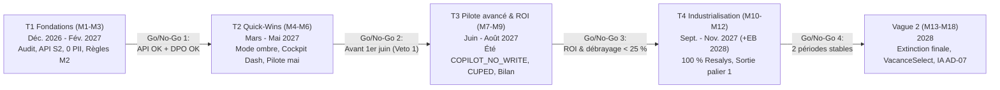

# Epics structurants, feuille de route 12 mois et gouvernance RACI

Ce document traduit le PRD exécutif ([04_prd_v2_asdste100.md](file:///C:/Users/Admin/Documents/TEMPLATE_GENERATE_ROADMAP%20-%20ECG/_bmad-output/planning-artifacts/04_prd_v2_asdste100.md)), le contrat d'architecture cible ([05_architecture.md](file:///C:/Users/Admin/Documents/TEMPLATE_GENERATE_ROADMAP%20-%20ECG/_bmad-output/planning-artifacts/05_architecture.md)) et les parades issues du test de résistance ([06_stress_test.md](file:///C:/Users/Admin/Documents/TEMPLATE_GENERATE_ROADMAP%20-%20ECG/_bmad-output/planning-artifacts/06_stress_test.md)) en un plan de pilotage de niveau direction. L'exercice applique les quatre étapes de découpage en Epics et macro-stories ainsi que la porte de maturité du sprint planning, puis projette l'exécution sur quatre trimestres opérationnels (décembre 2026 à novembre 2027, avec ouverture Early Booking 2028) sans descendre au niveau des tickets granulaires de développement.

L'enjeu financier impose cette discipline. European Camping Group génère 813 M EUR de chiffre d'affaires en 2025 (trajectoire de 885 M EUR en 2026 et 934 M EUR en 2027), supporte 67 % de coûts fixes et réalise 74 % de son chiffre d'affaires hébergement brut en juillet et août, tout en visant un retour du flux de trésorerie libre après loyers (FOCF) à +14 M EUR en 2027. La trajectoire protège intégralement la haute saison 2027, délivre des gains de marge dès le deuxième mois par règles déterministes et séquence la sortie du prestataire externe (`ORTEC #revcamp` ou `QRUSH`) en deux paliers réalistes entre fin 2027 et post-été 2028.

---

## 1. Validation des prérequis et inventaire des exigences (Step 1)

L'ensemble des documents d'entrée requis est complet, cohérent et vérifié. Aucun document UX séparé n'existe, mais les contrats d'interface, de latence et d'ergonomie du cockpit sont intégralement spécifiés dans le PRD, l'architecture et le stress-test. Les conflits détectés entre les versions initiales du PRD et la réalité physique, calendaire ou juridique ont été tranchés dans [06_stress_test.md](file:///C:/Users/Admin/Documents/TEMPLATE_GENERATE_ROADMAP%20-%20ECG/_bmad-output/planning-artifacts/06_stress_test.md) et sont embarqués comme exigences fermes dans le présent découpage.

### Inventaire consolidé des exigences

| Catégorie | Références couvertes | Synthèse opérationnelle et durcissements du stress-test intégrés |
| :--- | :--- | :--- |
| Exigences fonctionnelles (28) | `FR-01` à `FR-28` | Capacité A (`FR-01..06`): ingestion Resalys/Snowflake, audit contrefactuel, features versionnées et rejet PII. Capacité B (`FR-07..12`): prévision de demande, décontraction `Expectation-Maximization` sur `stop-sell` (primaire avant `Tealium/GA4`), élasticité causale monotone sur prix TTC post-TVA 2026, conversion net HT, pondération `IPW` des débrayages et amorçage M&A `< 48 h` sur contrat canonique 6 tables. Capacité C (`FR-13..18`): optimiseur double objectif net HT (marge annexe additive sites propres après coûts de rotation vs marge variable TO hors loyer fixe), bornes anti-volatilité, plafonds inter-pays, lissage CSE J-15, `MinLOS/CTA/CTD` et registre Omnibus 30 jours multi-axes actif dans `OR-Tools`. Capacité D (`FR-19..28`): cockpit unifié `Dash 4.5.0` sous `Cloud IAP`, explicabilité bicouche (`TreeSHAP` + contraintes `OR-Tools`), file d'exceptions `< 15 min`, corridors estivaux annuels, écriture `Delta-Only` Resalys + pré-chauffage caches, Champion/Challenger par micro-bassins (`CUPED`), veille publique frugale 50 bassins dès M3 puis extension et couche sémantique Vague 2. |
| Exigences non fonctionnelles (10) | `NFR-01` à `NFR-10` | Batch matinal clos avant `07h30 CET` (`< 20 min` d'inférence parallélisée par bassin, entraînement le week-end), latence cockpit `< 5 s` sans BI Engine, écriture Resalys `Delta-Only` (`<= 15 %` des cellules/jour sur `J-0..J+60`), socle serverless GCP incluant `Cloud Storage`, `Secret Manager`, `Artifact Registry`, `Cloud Monitoring`, `Cloud NAT` et `Cloud Run Service` unique (`Dash`), zéro GKE 24/7 ni Feature Store temps réel, archivage append-only 24 mois partitionné par `batch_date`, sonde de dérive hebdomadaire, repli natif sur grilles Resalys `< 30 min`, zéro PII (`L. 221-5`) et RBAC par zone (`Aix`, `Montpellier`, `Breda`, `Finance`). |
| Invariants d'architecture (7) | `AD-01` à `AD-07` | Découplage Resalys/GCP (`AD-01`), batch serverless sobre adapté à 12-15 experts (`AD-02`), liste blanche zéro PII + Omnibus 30 jours (`AD-03`), séparation prévision TTC / optimisation double objectif HT (`AD-04`), quarantaine `IPW` des débrayages et gel juin-août (`AD-05`), cockpit bicouche et Champion/Challenger anti-SUTVA (`AD-06`), couche sémantique certifiée préalable à tout assistant `AI Act art. 50` (`AD-07`). |
| Garde-fous et contingences | `Veto 1..5`, `Kill-switches 1..4`, `Pivots 1..3` | Interdiction absolue de première bascule en juin-juillet-août (`Veto 1`), de PII en entrée ML (`Veto 2`), de généralisation sans historique apparié (`Veto 3`), de repli supérieur à 2 heures (`Veto 4`) et de NL2SQL sur tables brutes (`Veto 5`). Arrêt automatique sur recul Net RevPAC `> 5 %`, anomalie parité checkout `> 1 %` (sonde 100 paniers), débrayage `> 40 %` ou incident conformité/fraîcheur. Bascule Plan B en 24 à 48h via les trois pivots (`shadow-tap` + sortie hybride, `Delta-Only` + repli natif, EM interne + file d'exceptions unique). |

---

## 2. Epics structurants et macro-stories de direction (Steps 2 et 3)

Le programme se structure en six Epics autonomes orientés valeur métier, et non par couches techniques. Les cinq premiers Epics composent le périmètre ferme de l'année 1 sur le cœur Resalys (`Homair`, `Eurocamp`, `Roan`, `Alannia`), dimensionné pour l'équipe de 12 à 15 experts d'Aix-en-Provence. Le sixième Epic isole la Vague 2 (`M13-M18`: coupure finale post-été 2028, raccordement `VacanceSelect Travel` et couche sémantique IA) afin d'empêcher toute dispersion avant la stabilisation du cœur tarifaire.

### Epic 1: audit contrefactuel, maîtrise de la physique Resalys et socle déterministe sans PII

Cet Epic donne à la direction financière, au DPO et aux équipes Revenue Management une preuve objective des écarts du moteur externe, une garantie technique sur la capacité d'écriture et de repli de Resalys, et une correction immédiate des fuites de marge évidentes dès le deuxième mois, sans attendre le machine learning. Il couvre `FR-01` à `FR-06`, `FR-15`, `FR-16`, `FR-18`, `NFR-03`, `NFR-04`, `NFR-06`, `NFR-08` et `NFR-09`, en alignement strict avec `AD-01`, `AD-02`, `AD-03` et `AD-06` ainsi que les Accélérateurs 1 et 2.

#### Macro-lot 1.1: audit contractuel externe, tir de charge Resalys S2 et repli natif sous 30 minutes
En tant que direction financière et direction IT, nous voulons vérifier dès les deux premières semaines les clauses de sortie du contrat externe, le débit réel de l'API GraphQL Resalys et le basculement sur grilles de sécurité afin d'éliminer tout risque de blocage tardif. L'acceptation exige un avis écrit sur les préavis et la propriété des logs `ORTEC/QRUSH` en S1, un banc de charge 2-ways mesuré en S2 avec SLA Snowflake fixé à `05h45 CET` (et bascule automatique `T-1 + delta 24h` à `06h00 CET`), et un exercice chronométré confirmant le retour sur grilles natives Resalys en moins de 30 minutes sans coupure de vente.

#### Macro-lot 1.2: socle BigQuery/Dataform append-only, liste blanche PII et registre Omnibus multi-axes
En tant que DPO et équipe Data, nous voulons disposer d'un pipeline quotidien partitionné par `batch_date`, filtré par liste blanche de colonnes et doté d'un historique promotionnel complet afin de sécuriser l'auditabilité 24 mois et la conformité `L. 221-5` et Omnibus. L'acceptation exige la signature DPO sur la liste blanche `pii_schema_guard` (avec quarantaine non bloquante des colonnes inconnues, scan DLP des textes libres et k-anonymat `>= 20`), le partitionnement immuable par `batch_date` dans `features_no_pii`, et la mise en ligne du registre Omnibus 30 jours indexé par `(brand_portal, market_country, public_vs_cse_scope, site_id, accommodation_category, arrival_date, los_bucket)` synchronisé sur les remises actives Resalys.

#### Macro-lot 1.3: audit contrefactuel et mise en production du moteur de règles déterministes Pareto 20/80
En tant que Revenue Management et Finance, nous voulons quantifier l'impact réel du prestataire externe via le capteur `shadow-tap` (`06h00 CET`) et convertir en règles `Dataform` les 20 % de couples site-gamme concentrant la moitié des fuites de marge et des débrayages VBA. L'acceptation exige un rapport d'audit contrefactuel chiffré en Net RevPAC HT et le déploiement dès M2 de règles dures bloquant les écarts inter-portails de 30 % à 40 %, les ventes sous planchers partenaires et les défauts de répercussion de la TVA 2026 (21 % aux Pays-Bas, 12 % en Belgique).

### Epic 2: moteur causal de prévision, optimisation double objectif et veille frugale en mode ombre

Cet Epic produit chaque matin en mode ombre des recommandations tarifaires économiquement cohérentes sur l'ensemble du parc cœur Resalys, prêtes à être confrontées au terrain avant toute écriture automatique. Il couvre `FR-07` à `FR-14`, `FR-17`, l'amorce frugale de `FR-27`, `NFR-01` et `NFR-05`, en alignement avec `AD-02`, `AD-04` et `AD-05` ainsi que les Accélérateurs 3 et 4.

#### Macro-lot 2.1: prévision décontractée interne et élasticité causale monotone post-TVA
En tant que Data Scientist Senior et Revenue Management, nous voulons estimer la demande réelle sans souffrir des refus de cookies CNIL ni de l'endogénéité historique des débrayages afin de fiabiliser les courbes d'élasticité sur les 17 marchés. L'acceptation exige une décontraction primaire par algorithme `Expectation-Maximization` sur les horodatages `stop-sell` de Resalys (`Tealium/GA4` redressé CMP en covariable secondaire), un estimateur causal Double ML sous `XGBoost` avec contrainte monotone négative sur le prix TTC rebasé post-TVA 2026, une pondération `IPW` des observations débrayées (abandon de la suppression brute), une table de change FX (`GBP/CHF/PLN`) et la suppression définitive des `Random Fourier Features`.

#### Macro-lot 2.2: optimiseur double objectif net HT et exécution matinale parallélisée
En tant que direction financière et Revenue Management, nous voulons maximiser la contribution nette réelle selon le statut contractuel du camping tout en tenant la fenêtre matinale sans infrastructure temps réel. L'acceptation exige deux fonctions objectifs distinctes sous `OR-Tools` (sites propres avec marge annexe nette additive en EUR HT déduction faite des 40 à 60 EUR de coûts variables de rotation; sites partenaires TO en marge marginale nette hors loyer fixe garanti, intégrant commissions variables, planchers et substitution intra-bassin), le respect des bornes anti-volatilité, du lissage CSE `Linéaire J-15`, des restrictions `MinLOS/CTA/CTD` et de la contrainte active Omnibus, le tout exécuté en moins de 20 minutes via environ 20 tâches `Cloud Run Jobs` parallélisées par bassin (entraînement `Optuna` basculé le week-end).

#### Macro-lot 2.3: veille publique frugale 50 bassins et gabarit d'amorçage M&A
En tant que Revenue Management et direction M&A, nous voulons disposer dès M3 d'un signal concurrentiel public sur les bassins sensibles à la TVA et d'un onboarding rapide pour les 5 à 10 acquisitions annuelles. L'acceptation exige une collecte frugale strictement limitée aux prix publics affichés sur 50 bassins prioritaires avec registre de provenance et respect `robots.txt`, ainsi qu'un contrat d'ingestion M&A standardisé sur 6 tables canoniques permettant l'amorçage par campings jumeaux en moins de 48 heures une fois BigQuery alimenté.

### Epic 3: cockpit d'explicabilité bicouche, gestion par exceptions et souveraineté estivale

Cet Epic supprime l'effet boîte noire qui bloquait l'adoption du moteur externe et ramène la revue matinale des pôles d'Aix-en-Provence, de Montpellier et de Breda sous la barre des 15 minutes par analyste. Il couvre `FR-19` à `FR-23`, `NFR-02` et `NFR-10`, en alignement avec `AD-05` et `AD-06` ainsi que le Pivot 3.

#### Macro-lot 3.1: cockpit unifié `Dash 4.5.0` sous `Cloud IAP` et explicabilité bicouche sur 10 sentinelles
En tant que Revenue Manager, je veux consulter en moins de 5 secondes l'origine exacte d'un tarif recommandé et simuler un prix alternatif sans jongler entre deux outils. L'acceptation exige le déploiement d'un micro-service unique `Dash 4.5.0` sur `Cloud Run Service` derrière `Google Cloud IAP` (RBAC par zone `Aix`, `Montpellier`, `Breda`, `Finance`, `Tableau` restant dédié au reporting Finance mensuel), servi par des tables BigQuery matérialisées, et affichant dès M3 sur 10 campings sentinelles une décomposition bicouche séparant les valeurs `TreeSHAP` de demande des contraintes actives et variables duales d'`OR-Tools`.

#### Macro-lot 3.2: file d'exceptions par impact EBITDA, corridors estivaux et saisie groupée
En tant que Revenue Manager, je veux concentrer mon arbitrage sur les 50 à 100 mouvements critiques du matin et protéger toute l'année les séjours de juillet-août contre toute dérive d'automatisation. L'acceptation exige le remplacement de la revue unitaire exhaustive par une file d'exceptions classée en euros d'EBITDA (`< 15 min/jour/analyste`), des corridors hebdomadaires signés (`+/- 2 %` auto-publiés hors pointe, gel strict toute l'année sur les `stay_date` de juillet-août), et la saisie groupée (`bulk override`) associée aux six codes motifs structurés dans `ops_overrides`.

#### Macro-lot 3.3: sonde nocturne anti-contournement et boucle bimensuelle "Modèle vs RM"
En tant que responsable Pricing et direction commerciale, nous voulons mesurer les contournements opérés directement dans Resalys et faire converger le modèle avec l'expertise terrain. L'acceptation exige un `Shadow Override Tracker` nocturne comparant chaque jour `pricing_decisions` aux prix actifs dans `raw_resalys`, et la tenue dès M2 d'un atelier bimensuel de 45 minutes examinant les 10 plus forts écarts de Net RevPAC HT entre le modèle et les décisions terrain.

### Epic 4: pilote contrôlé Champion/Challenger, publication `Delta-Only` et protection estivale

Cet Epic réalise la première mise en production tarifaire avant le verrou du 1er juin (`Veto 1`), démontre la fiabilité mécanique de l'écriture vers Resalys et traverse l'été 2027 en mode copilote sécurisé pour collecter une donnée estivale propre. Il couvre `FR-24` à `FR-26`, `NFR-03`, `NFR-07` et `NFR-08`, en alignement avec `AD-01`, `AD-05` et `AD-06` ainsi que les Pivots 1 et 2.

#### Macro-lot 4.1: publication différentielle `Delta-Only`, pré-chauffage caches et sonde parité 100 paniers
En tant qu'équipe IT et e-commerce, nous voulons écrire dans Resalys sans saturer l'API GraphQL ni créer d'écart de prix entre le catalogue et le paiement. L'acceptation exige la mise en service de `resalys-publisher-job` derrière une IP fixe `Cloud NAT`, filtrant les écritures sur les écarts significatifs (`>= 2-3 %` ou `>= 5 EUR` ou changement `MinLOS/CTA/CTD`, priorisés sur `J-0..J+60` soit `<= 15 %` des cellules/jour), suivi du pré-chauffage des caches `semainier` et `journalier` et d'une sonde synthétique matinale vérifiant 100 paniers types avant `07h25 CET` (alerte `> 0,5 %`, kill-switch `> 1 %`).

#### Macro-lot 4.2: protocole Champion/Challenger par micro-bassins et activation des quatre kill-switches
En tant que direction financière et Data Science, nous voulons mesurer le gain réel de Net RevPAC HT sans biais de report entre campings voisins et sécuriser l'exploitation par des arrêts automatiques fiables. L'acceptation exige une randomisation par grappes de micro-bassins géographiques étanches (anti-SUTVA) dimensionnée par calcul de puissance (`MDE <= 3 %`, puissance `80 %`, réduction de variance `CUPED`), une sonde hebdomadaire de dérive (`MAPE/WAPE`) et l'activation testée des quatre kill-switches avec suspension automatique de publication.

#### Macro-lot 4.3: bascule pré-estivale (mai 2027) et régime copilote estival (`COPILOT_NO_WRITE`)
En tant que direction générale, nous voulons prouver la valeur du moteur interne dès le printemps 2027 sans prendre le moindre risque sur les 74 % de chiffre d'affaires de juillet-août. L'acceptation exige une bascule contrôlée en mai 2027 sur les ailes de printemps, les courts séjours hors samedi-samedi, les resorts ouverts à l'année (`Alannia`) et les acquisitions raccordées, suivie du verrouillage strict `PUBLISH_MODE=COPILOT_NO_WRITE` du 1er juin au 31 août 2027 (zéro écriture automatique estivale, collecte intégrale des arbitrages et stabilité prouvée du batch avant `07h30 CET`).

### Epic 5: généralisation cœur Resalys, campagne Early Booking 2028 et sortie palier 1

Cet Epic étend le moteur interne à 100 % du parc opéré sous Resalys dès la fin de l'été 2027, pilote la montée en charge critique de l'Early Booking 2028 et déclenche la réduction contractuelle du prestataire externe. Il consolide `FR-24` à `FR-26` et `NFR-06` à l'échelle industrielle, en alignement avec `AD-01`, `AD-02`, `AD-05` et `AD-06`.

#### Macro-lot 5.1: généralisation multi-marques cœur Resalys et industrialisation MLOps
En tant que VP IT, Digital & Data et Revenue Management, nous voulons étendre la plateforme aux 450+ destinations cœur Resalys (`Homair`, `Eurocamp`, `Roan`, `Alannia`) pour l'arrière-saison 2027 et l'ouverture Early Booking 2028 (clientèles néerlandaise et allemande dès octobre 2027). L'acceptation exige un déploiement complet par `Terraform` et `GitHub Actions` sur trois environnements (`dev`, `staging`, `prod`), l'arrêt ou l'isolation définitive du fork R&D `ecg_jupyterhub_deployment`, un taux de débrayage stabilisé sous 25 % et une traçabilité 24 mois vérifiée sur chaque décision publiée.

#### Macro-lot 5.2: audit ROI Finance et sortie contractuelle palier 1 du moteur externe
En tant que direction financière et achats, nous voulons valider l'impact sur le Net RevPAC HT et amorcer la baisse des coûts de licence externe sans perdre le filet de sécurité avant la saison 2028. L'acceptation exige un dossier ROI audité par la Finance sur les segments basculés (cible `+3 % à +5 %` Net RevPAC HT à contre-métriques vertes) et la signature de l'avenant de sortie palier 1 (contrat passerelle réduit couvrant uniquement la transition vers l'extinction post-été 2028).

### Epic 6 (cadrage T4 / exécution Vague 2, M13-M18): extinction finale, VacanceSelect Travel et couche sémantique IA

Cet Epic rassemble volontairement les chantiers hors cœur Resalys reportés par le stress-test afin de protéger la bande passante de l'équipe en année 1 tout en assurant une couverture intégrale du PRD (`FR-27` étendu, `FR-28`, `Veto 5`, `AD-03`, `AD-07`).

#### Macro-lot 6.1: coupure définitive du prestataire externe, VacanceSelect Travel et veille élargie
En tant que direction générale et IT, nous voulons éteindre toute double licence après validation de la saison estivale 2028 et unifier le périmètre secondaire dans BigQuery. L'acceptation exige la résiliation définitive du moteur externe après preuve estivale 2028, la mise en production du connecteur batch isolé pour `VacanceSelect Travel` (`PHP/MariaDB/XML Connect`) et l'extension de la veille tarifaire publique multi-pays.

#### Macro-lot 6.2: couche sémantique certifiée BigQuery et qualification de l'assistant `AI Act art. 50`
En tant que direction financière et DPO, nous voulons ouvrir l'analyse conversationnelle uniquement lorsque le cœur tarifaire est stabilisé et que la fiabilité comptable est prouvée. L'acceptation exige deux périodes consécutives à moins de 25 % de débrayage avant démarrage, la certification par la Finance de 4 à 5 KPI dans `semantic_governed` (`net_revpac_ht`, `net_margin_ht`, `adr_ttc_ht`, `booking_pace`, `override_rate`), l'interdiction technique de tout NL2SQL sur tables brutes, un score d'exactitude supérieur ou égal à 95 % sur 30 à 50 requêtes financières étalons et l'affichage de la mention `AI Act art. 50` dès le premier message.

---

## 3. Validation finale et porte de maturité (Step 4 et Readiness Gate)

La validation croisée vérifie trois conditions: couverture exhaustive des exigences sans orphelin, absence de dépendance vers un Epic futur et capacité réelle de mise en œuvre par une équipe de 12 à 15 experts.

### Matrice de couverture complète (FR, NFR, AD et stress-test)

| Epic | Exigences FR couvertes | Exigences NFR couvertes | Invariants AD couverts | Parades du stress-test intégrées | Dépendances amont |
| :--- | :--- | :--- | :--- | :--- | :--- |
| Epic 1 (T1) | `FR-01`, `FR-02`, `FR-03`, `FR-04`, `FR-05`, `FR-06`, `FR-15`, `FR-16`, `FR-18` | `NFR-03`, `NFR-04`, `NFR-06`, `NFR-08`, `NFR-09` | `AD-01`, `AD-02`, `AD-03`, `AD-06` | Benchmark API S2, repli natif `< 30 min`, audit ORTEC S1, `shadow-tap`, liste blanche PII + DLP, Omnibus multi-axes, moteur règles Pareto 20/80 M2 | Aucune (autonome) |
| Epic 2 (T2) | `FR-07`, `FR-08`, `FR-09`, `FR-10`, `FR-11`, `FR-12`, `FR-13`, `FR-14`, `FR-17`, `FR-27` (50 bassins) | `NFR-01`, `NFR-05` | `AD-02`, `AD-04`, `AD-05` | Décontraction EM sur `stop-sell`, Double ML monotone + `IPW`, suppression `RFF`, marge annexe additive (coûts rotation), exclusion loyer fixe TO, parallélisation `< 20 min`, gabarit M&A 6 tables `< 48 h`, veille frugale M3 | Epic 1 (`features_no_pii`) |
| Epic 3 (T2-T3) | `FR-19`, `FR-20`, `FR-21`, `FR-22`, `FR-23` | `NFR-02`, `NFR-10` | `AD-05`, `AD-06` | Cockpit unique `Dash 4.5.0` + `Cloud IAP`, explicabilité bicouche (`TreeSHAP` + `OR-Tools`), file d'exceptions `< 15 min`, corridors `stay_date` juillet-août gelés, `bulk override`, `Shadow Override Tracker` | Epic 2 (`pricing_decisions`) |
| Epic 4 (T3) | `FR-24`, `FR-25`, `FR-26` | `NFR-03`, `NFR-07`, `NFR-08` | `AD-01`, `AD-05`, `AD-06` | Écriture `Delta-Only` (`Cloud NAT`, `J-0..J+60`), sonde parité 100 paniers (`07h25 CET`), Champion/Challenger par micro-bassins (`CUPED`), pilote mai 2027 avant `Veto 1`, été en `COPILOT_NO_WRITE` | Epics 1, 2 et 3 |
| Epic 5 (T4) | `FR-24`, `FR-25`, `FR-26` (échelle 100 % Resalys) | `NFR-04`, `NFR-06`, `NFR-07` | `AD-01`, `AD-02`, `AD-05`, `AD-06` | Généralisation cœur Resalys (ailes + Early Booking 2028), arrêt fork GKE/Ray, sortie prestataire palier 1 validée Finance | Epic 4 |
| Epic 6 (Vague 2) | `FR-27` (étendu), `FR-28` | `NFR-09` | `AD-03`, `AD-07` | Décalage `VacanceSelect Travel` et chatbot en `M13-M18`, extinction finale post-été 2028, seuil `>= 95 %` sur 30-50 requêtes étalons et mention `AI Act art. 50` | Epic 5 (2 périodes `< 25 %` débrayage) |

### Verdict de la porte de maturité (`Readiness Gate`)

Le verdict est **PASS sous conditions de levée des jalons S1-S2**. Les 28 exigences fonctionnelles, les 10 exigences non fonctionnelles et les 7 invariants `AD-01..AD-07` sont intégralement tracés sans orphelin ni dépendance inversée. Aucun Epic ne réclame la réalisation d'un Epic ultérieur pour produire une valeur mesurable. Les trois incertitudes externes non maîtrisables avant le jour 1 (clauses exactes du contrat ORTEC/QRUSH, débit réel de l'API GraphQL Resalys et taux d'opt-out cookies par pays) sont placées en tête de T1 (semaines 1 à 4) et couvertes par les Pivots 1, 2 et 3 activables en 24 à 48 heures.

---

## 4. Feuille de route exécutive sur 12 mois en quatre trimestres

La traduction du sprint planning (24 itérations de deux semaines) en trajectoire annuelle aligne la cadence d'ingénierie sur la saisonnalité commerciale d'ECG et sur le verrou `Veto 1` du 1er juin 2027.

### Trimestre 1 (M1 à M3, décembre 2026 à février 2027): fondations et sécurisation

Le premier trimestre (sprints 1 à 6) lève tous les verrous physiques, contractuels et juridiques avant d'écrire la moindre ligne de machine learning, tout en corrigeant dès M2 les fuites de marge évidentes. En semaines 1 et 2, la direction financière audite le contrat `ORTEC/QRUSH` (préavis, double facturation, propriété des logs), l'équipe IT exécute le tir de charge Resalys 2-ways/GraphQL et chronomètre le repli natif sous 30 minutes, et le capteur `shadow-tap` (`06h00 CET`) démarre si l'historique externe est incomplet. En parallèle, l'équipe Data déploie l'infrastructure `Terraform` (datasets `batch_date` append-only, `Cloud NAT`, `Secret Manager`), fait signer la liste blanche `pii_schema_guard` par le DPO en S4, met en ligne le registre Omnibus 30 jours multi-axes et tranche l'architecture unique `Dash 4.5.0` sous `Cloud IAP`. Dès M2, les règles métier extraites par Pareto 20/80 des classeurs VBA et SQL Server passent en production dans `Dataform` pour supprimer les écarts inter-portails de 30 % à 40 %, verrouiller les planchers TO et aligner la TVA 2026 (NL 21 %, BE 12 %).

**Livrable tangible T1**: socle BigQuery/Dataform certifié zéro PII (`pii_schema_guard` validé DPO), rapport d'audit contrefactuel et benchmark Resalys validant le repli `< 30 min`, et moteur de règles déterministes Pareto 20/80 actif en production dès M2.

### Trimestre 2 (M4 à M6, mars à mai 2027): quick-wins, mode ombre et première bascule pré-estivale

Le deuxième trimestre (sprints 7 à 12) délivre le cœur algorithmique et le cockpit opérationnel, puis enclenche une première mise en production bornée en mai 2027 avant le gel estival du 1er juin (`Veto 1`). Les sprints 7 à 9 livrent la tranche verticale sur 10 campings sentinelles (5 sites propres dont `Alannia`, 5 partenaires TO) avec décontraction `Expectation-Maximization` sur les `stop-sell` Resalys, modèle causal Double ML monotone (`XGBoost`, pondération `IPW`), optimiseur `OR-Tools` double objectif net HT (marge annexe additive sites propres vs marge variable TO hors loyer fixe), exécution matinale parallélisée sous 20 minutes et veille publique frugale sur 50 bassins prioritaires. Les pôles d'Aix, Montpellier et Breda prennent en main le cockpit `Dash 4.5.0` (explicabilité bicouche `TreeSHAP + OR-Tools`, file d'exceptions `< 15 min`, saisie groupée et `Shadow Override Tracker`). Aux sprints 11 et 12 (mai 2027), après validation de la sonde de parité 100 paniers (`<= 0,5 %`) et des quatre kill-switches, le pilote Champion/Challenger par micro-bassins (`CUPED`) bascule en écriture `Delta-Only` sur les ailes de printemps, les courts séjours hors samedi-samedi, `Alannia` et les acquisitions raccordées.

**Livrable tangible T2**: cockpit unifié `Dash 4.5.0` (`< 5 s`, explicabilité bicouche) adopté sur Aix, Montpellier et Breda, et premier pilote Champion/Challenger en production réelle `Delta-Only` (ailes de printemps, courts séjours, `Alannia`, M&A) opérationnel avant le 1er juin.

### Trimestre 3 (M7 à M9, juin à août 2027): pilote avancé, copilote estival et preuve ROI

Le troisième trimestre (sprints 13 à 18) protège intégralement les 74 % de chiffre d'affaires estival tout en démontrant la solidité financière et opérationnelle de la plateforme. Du 1er juin au 31 août, le drapeau `PUBLISH_MODE=COPILOT_NO_WRITE` interdit toute écriture automatique sur les séjours d'été (`Veto 1`), tandis que les corridors hebdomadaires (`+/- 2 %`) restent actifs sur les segments hors pointe déjà basculés. Les Revenue Managers utilisent quotidiennement la file d'exceptions bicouche en mode copilote, renseignent 100 % des motifs structurés (`bulk override`) et confrontent les recommandations au marché lors des ateliers bimensuels "Modèle vs RM". Cette discipline constitue une base d'apprentissage estivale propre, recalibre l'élasticité haute saison sur les prix post-TVA 2026 et valide en continu la stabilité du batch matinal (`< 07h30 CET`), la sonde de dérive hebdomadaire (`MAPE/WAPE`) et la parité checkout. En fin de trimestre, la Finance et la Data Science produisent le bilan statistique Champion/Challenger (`CUPED`) sur les segments pilotes afin d'autoriser la généralisation de septembre.

**Livrable tangible T3**: bilan ROI audité Champion/Challenger sur les segments pilotes (ailes, courts séjours, `Alannia`), stabilité prouvée du batch matinal et base d'apprentissage estivale complète (`100 %` de motifs capturés et réconciliés dans `Shadow Override Tracker`) sans exposition du chiffre d'affaires d'été.

### Trimestre 4 (M10 à M12, septembre à novembre 2027 et ouverture Early Booking 2028): industrialisation et sortie palier 1

Le quatrième trimestre (sprints 19 à 24) généralise le moteur interne à 100 % du parc cœur Resalys (`Homair`, `Eurocamp`, `Roan`, `Alannia`) et sécurise la rentabilité de la saison suivante. En septembre et octobre 2027, la plateforme prend en charge les ailes d'arrière-saison puis l'ouverture critique Early Booking 2028 sur les marchés néerlandais et allemand (délai moyen d'anticipation de 93 jours). L'équipe finalise l'industrialisation MLOps (`Terraform`, `GitHub Actions`, auditabilité immuable 24 mois, arrêt du fork GKE/Ray) et standardise l'onboarding des nouvelles acquisitions via le gabarit canonique à 6 tables (`< 48 h` d'amorçage ML). Sur la base du gain Net RevPAC HT validé par la Finance (`+3 % à +5 %` cible à contre-métriques vertes et débrayage `< 25 %`), ECG active le palier 1 de sortie du prestataire externe (bascule sur contrat passerelle léger jusqu'à l'extinction définitive après l'été 2028) et valide le dossier d'engagement de la Vague 2 (`M13-M18`: `VacanceSelect Travel` et couche sémantique `AD-07`).

**Livrable tangible T4**: plateforme interne industrialisée en production sur l'ensemble du parc cœur Resalys (450+ destinations cœur, SLA `< 07h30 CET`, débrayage `< 25 %`), dossier ROI Finance validé et avenant de sortie palier 1 du prestataire externe signé.

### Synthèse des jalons Go/No-Go et livrables par trimestre

| Trimestre | Horizon | Epics actifs | Livrable tangible de fin de trimestre | Critère Go/No-Go devant le comité de direction |
| :--- | :--- | :--- | :--- | :--- |
| T1 Fondations | M1-M3 (déc. 2026 - fév. 2027) | Epic 1 | Socle BigQuery/Dataform 0 PII, benchmark Resalys `< 30 min`, audit contrefactuel et règles déterministes Pareto 20/80 en production M2 | Capacité API prouvée, liste blanche DPO signée, notice contrat externe clarifiée et fuites de marge stoppées |
| T2 Quick-Wins | M4-M6 (mars - mai 2027) | Epics 2 et 3, amorce Epic 4 | Cockpit `Dash 4.5.0` bicouche (`< 5 s`) déployé sur 3 pôles et premier pilote Champion/Challenger `Delta-Only` en prod avant le 1er juin | WAPE et cohérence économique validés sur 10 sentinelles, revue `< 15 min/j`, sonde parité `<= 0,5 %` et zéro infraction `Veto 1` |
| T3 Pilote avancé / ROI | M7-M9 (juin - août 2027) | Epics 3 et 4 | Bilan ROI Champion/Challenger (`CUPED`) sur segments pilotes et base d'apprentissage estivale complète en mode `COPILOT_NO_WRITE` | Gains confirmés hors pic, débrayage `< 25 %`, zéro incident parité/latence et recalibration haute saison achevée |
| T4 Industrialisation | M10-M12 (sept. - nov. 2027 + EB 2028) | Epic 5, cadrage Epic 6 | Généralisation 100 % cœur Resalys (arrière-saison + Early Booking 2028), auditabilité 24 mois et avenant de sortie externe palier 1 | Cible `+3 % à +5 %` Net RevPAC HT validée Finance, contre-métriques vertes sur 2 périodes et feu vert Vague 2 (`M13-M18`) |

---

## 5. Matrice de gouvernance RACI

La gouvernance répartit clairement les responsabilités entre quatre acteurs: le **Data Scientist Senior (Pricing & Revenue Management)** (rôle cible du mandat d'Aix-en-Provence décrit dans [offre.md](file:///C:/Users/Admin/Documents/TEMPLATE_GENERATE_ROADMAP%20-%20ECG/00_inputs/offre.md)), le **Métier** (équipes Revenue Management d'Aix-en-Provence, Montpellier et Breda, ainsi que la direction financière), la direction **Tech / Data** (Data Engineering, IT Resalys, MLOps et architecture GCP au sein de l'équipe de 12 à 15 experts) et le pôle **Juridique / DPO** (conformité RGPD, ordonnance 2026-2 art. L. 221-5, directive Omnibus, AI Act et gestion contractuelle).

Chaque ligne comporte exactement un **A** (Accountable, décideur final qui approuve et assume la responsabilité) afin d'éviter toute zone grise en cas d'incident de production ou d'arbitrage commercial. **R** désigne l'exécutant principal, **C** la partie consultée avant décision et **I** la partie informée.

| Activité structurante et jalon de pilotage | Data Scientist Senior (ce rôle) | Métier (RM & Finance) | Tech / Data (DE, IT Resalys, MLOps) | Juridique / DPO |
| :--- | :---: | :---: | :---: | :---: |
| Audit contrefactuel du modèle externe et cadrage ROI (`M1-M2`) | **R** | **A** | **C** | **I** |
| Audit contractuel `ORTEC/QRUSH` et avenant de sortie palier 1 / extinction | **C** | **A** | **C** | **R** |
| Benchmark API Resalys 2-ways, SLA Snowflake `05h45 CET` et repli `< 30 min` | **C** | **I** | **A / R** | **I** |
| Liste blanche `pii_schema_guard`, DLP textes libres et k-anonymat (`AD-03`) | **C** | **I** | **R** | **A** |
| Registre Omnibus 30 jours multi-axes et contrôle promos actives Resalys | **C** | **C** | **R** | **A** |
| Conversion règles VBA/SQL Server Pareto 20/80 en moteur déterministe (`M2`) | **R** | **A** | **R** | **C** |
| Modélisation causale (EM `stop-sell`, Double ML monotone, `IPW`, FX) | **A / R** | **C** | **C** | **I** |
| Optimiseur `OR-Tools` double objectif net HT (sites propres vs TO hors loyer fixe) | **R** | **A** | **C** | **C** |
| Veille tarifaire publique frugale 50 bassins (registre source, `robots.txt`) | **R** | **C** | **R** | **A** |
| Conception du cockpit `Dash 4.5.0`, explicabilité bicouche et simulateur | **R** | **A** | **R** | **I** |
| Corridors hebdomadaires (`+/- 2 %`), gel `stay_date` juillet-août et motifs débrayage | **C** | **A / R** | **C** | **I** |
| Publication `Delta-Only`, pré-chauffage caches et sonde parité 100 paniers | **C** | **I** | **A / R** | **I** |
| Protocole Champion/Challenger par micro-bassins (`CUPED`) et audit ROI | **R** | **A** | **C** | **I** |
| Surveillance dérive hebdo (`MAPE/WAPE`) et activation des 4 kill-switches | **R** | **C** | **A / R** | **I** (escalade si KS-4) |
| Généralisation 100 % cœur Resalys, MLOps `Terraform` et auditabilité 24 mois | **R** | **C** | **A / R** | **C** |
| Cadrage Vague 2 (`VacanceSelect Travel`) et socle sémantique `semantic_governed` | **R** | **C** | **A** | **C** |
| Qualification conformité `AI Act art. 50` et ouverture assistant conversationnel | **R** | **C** | **C** | **A** |

### Cadence de gouvernance opérationnelle

Le pilotage repose sur trois rituels courts adaptés à la taille de l'équipe. Un **atelier bimensuel "Modèle vs RM"** de 45 minutes, animé par le Data Scientist Senior avec les leads RM d'Aix, Montpellier et Breda, traite les 10 plus forts écarts de Net RevPAC HT issus du `Shadow Override Tracker` et ajuste les règles ou bornes sans alourdir la journée des analystes. Un **comité mensuel de direction Pricing**, réunissant la Finance, le VP IT/Digital/Data, le Revenue Management, le Data Scientist Senior et le DPO, valide les résultats Champion/Challenger, arbitre les passages de jalons Go/No-Go trimestriels et suit la trajectoire de sortie du prestataire externe. Enfin, un **protocole d'escalade incident sous 2 heures** relie directement les alertes `Kill-switches 1..4` à l'astreinte Tech/Data et au lead RM concerné afin de déclencher le basculement sur grille native Resalys en moins de 30 minutes puis de documenter la cause racine avant toute réactivation.
